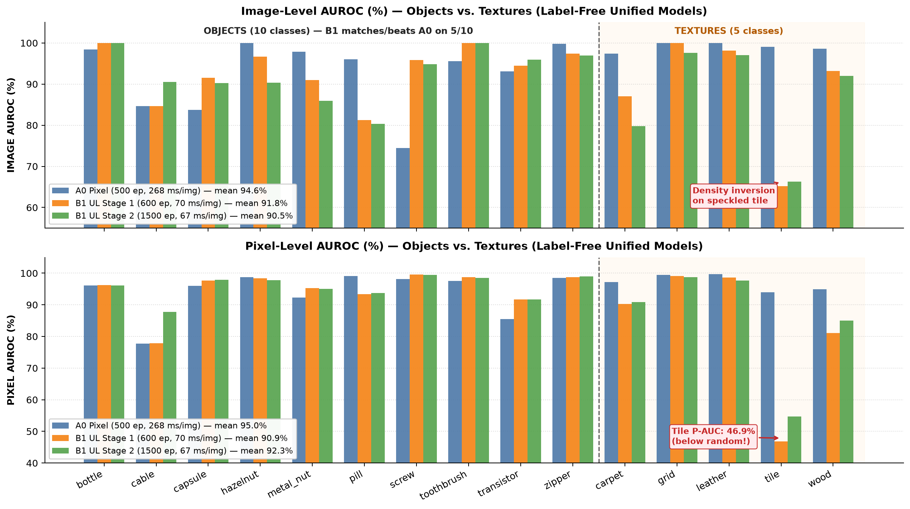
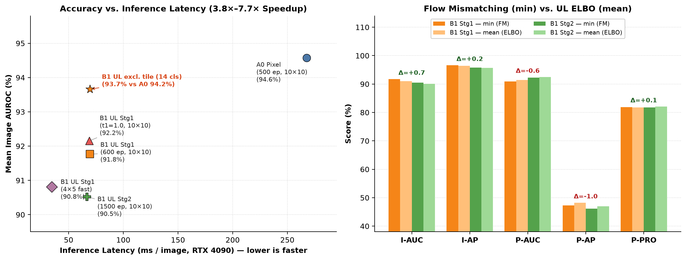
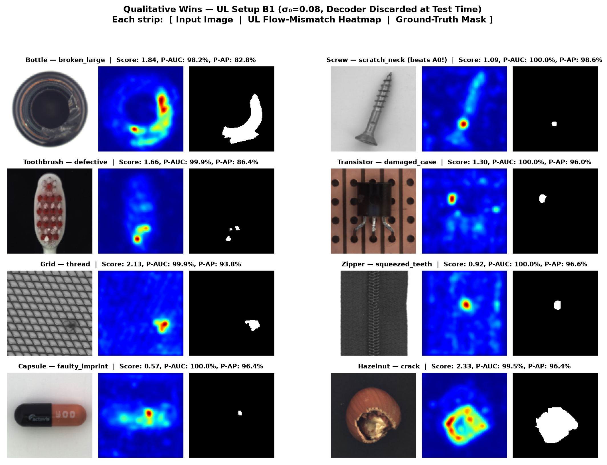
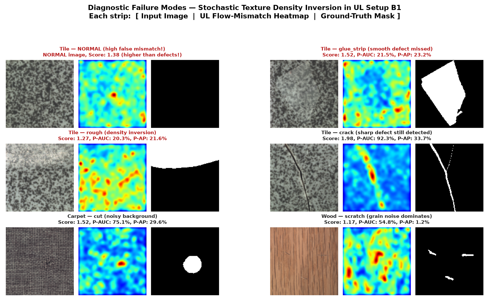
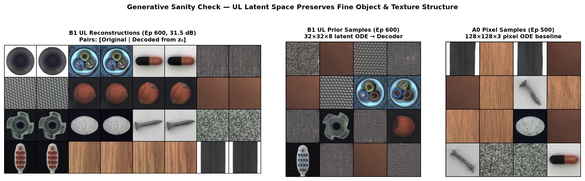

# Unified Latents for Flow Mismatching Anomaly Detection

Unsupervised anomaly detection combining **Unified Latents (UL)** with **Flow Mismatching**: train a UL encoder, $\sigma_0$-linked flow prior, and train-only diffusion decoder exclusively on normal images, **discard the decoder at test time**, and score anomalies via velocity discrepancies directly on the compact UL flow prior.

> **Provenance:** This codebase builds directly on [ShengzheC/Flow-Mismatching](https://github.com/ShengzheC/Flow-Mismatching) (base commit `2519636`, [arXiv:2605.23070](https://arxiv.org/abs/2605.23070), NeurIPS 2026) and adds a PyTorch implementation of **Unified Latents (UL)** ([Heek et al., 2026, arXiv:2602.17270](https://arxiv.org/abs/2602.17270)) together with latent-space baselines (frozen SD-VAE, frozen DINOv2 + UL adapter) and bitrate/ELBO diagnostics.

---

## Overview

Pixel-space [Flow Mismatching](https://arxiv.org/abs/2605.23070) detects anomalies without test-time reconstruction or ODE integration by probing a learned velocity field $v_\theta(x_t, t)$ along $K$ straight affine paths and aggregating local squared velocity discrepancies. However, operating in `128×128×3` pixel space requires $K \times T = 100$ full-resolution U-Net forward passes per test image (~268 ms/image on an RTX 4090) and struggles on large structural/semantic anomalies.

We extend Flow Mismatching into latent space using **Unified Latents (UL)**:
- **Joint training on normal data only:** A deterministic encoder $E_\psi$ produces latents $z_{\text{clean}} = E_\psi(x)$ with fixed base noise $\sigma_0$ and log-SNR $\lambda_0 = \log\frac{1 - \sigma_0^2}{\sigma_0^2}$, regularized by an exact Flow-Matching prior ELBO on $t \in (0, t_1)$ with $t_1 = \mathrm{sigmoid}(\lambda_0 / 2)$, while a lightweight diffusion decoder $D_\omega$ reconstructs pixels via UL's sigmoid-weighted loss.
- **Decoder-free test-time scoring:** At inference, $D_\omega$ is discarded. Test images are encoded once as $z = E_\psi(y)$ and scored directly on the compact latent flow prior $v_\theta$ using Flow Mismatching (`--aggregation min`) or raw UL prior ELBO (`--aggregation mean`), achieving **3.8×–7.7× faster inference**.
- **Controlled comparisons:** Supports four unified modeling spaces (`--space`) under the exact same scoring engine and 7-metric evaluation harness:

| Setup | `--space` | Latent Representation | Flow Prior | Test-Time Decoder |
| --- | --- | --- | --- | --- |
| **A0** (Baseline) | `pixel` | Pixel space (`128×128×3`) | 6-stage U-Net | None |
| **A1** (Frozen VAE) | `vae` | Frozen SD-VAE (`32×32×4`, standardized) | 3-stage latent U-Net | None |
| **B** (UL from scratch) | `ul` / `ul_stage2` | Learned UL encoder + fixed $\sigma_0$ (`32×32×8`) | Joint UL flow prior $v_\theta$ (or Stage-2 FM) | None; train-only $D_\omega$ |
| **C** (Semantic UL) | `ul_dino` | Frozen DINOv2 ViT-S/14 (`16×16×384`) + UL adapter (`16×16×C`) | Joint UL flow prior $v_\theta$ | None; train-only $D_\omega$ |

---

## Results Summary (MVTec-AD, Label-Free `--no-class_cond`)

Evaluated on all 15 MVTec-AD classes under strictly label-free unified modeling (`--no-class_cond`) on a single RTX 4090:

| Setup (all label-free `--no-class_cond`) | Image AUROC | Image AP | Pixel AUROC | Pixel AP | Pixel AUPRO | Latency (ms/img) | Speedup |
| --- | ---: | ---: | ---: | ---: | ---: | ---: | ---: |
| **A0 Pixel Baseline** (`128×128×3`, 500/2000 ep, `10×10`) | **94.57%** | **97.85%** | **94.99%** | **60.69%** | **89.16%** | 267.7 ms | 1.0× |
| **B1 UL Stage 1** (`sigma0=0.08`, 600 ep, `min`, `t1=0.926`) | 91.77% | 96.63% | 90.91% | 47.26% | 81.92% | 69.6 ms | **3.8×** |
| **B1 UL Stage 1** (`min`, `t1=1.0`) | 92.15% | 96.83% | 90.85% | 46.59% | 82.37% | 69.0 ms | **3.9×** |
| **B1 UL Stage 1** (`mean` = raw UL ELBO) | 91.02% | 96.45% | 91.46% | 48.27% | 81.78% | 69.7 ms | **3.8×** |
| **B1 UL Stage 1 Fast** (`4×5`) | 90.81% | 96.31% | 90.95% | 47.21% | 80.96% | **34.6 ms** | **7.7×** |
| **B1 UL Stage 2** (frozen $E_\psi$, 1500 ep uniform FM) | 90.52% | 95.82% | 92.26% | 46.13% | 81.77% | 66.9 ms | **4.0×** |
| **B1 UL Stage 1 excl. `tile`** *(14/15 classes)* | **93.66%** | 97.52% | **94.06%** | 50.07% | 86.33% | 69.6 ms | **3.8×** |

### Visual Comparisons

| Per-Class Performance (Objects vs. Textures) | Speed–Accuracy & `min` vs. `mean` (ELBO) |
| :---: | :---: |
|  |  |

<details>
<summary>Qualitative heatmaps, failure-mode diagnostics, and UL generative sanity checks</summary>

**Qualitative Wins (Decoder Discarded at Test Time)**


**Diagnostic Failure Modes (Stochastic Texture Density Inversion on `tile`, `carpet`, `wood`)**


**UL Generative Sanity Check (Reconstructions & Unconditional Prior Samples)**


</details>

---

## Code Structure

Files marked **`[new]`** were added for Unified Latents and latent-space baselines; files marked **`[extended]`** build on [ShengzheC/Flow-Mismatching](https://github.com/ShengzheC/Flow-Mismatching).

```text
train.py                           # [extended] pixel, frozen VAE, UL (Stage 1 & 2), and DINOv2+UL training
evaluate.py                        # [extended] 7-metric eval, latency logging, UL bitrate & OOD recon diagnostics
flow_mismatching/
├── scoring.py                     # [extended] channel-agnostic velocity mismatch heatmap, upsampling, t_range
├── metrics.py                     # AUROC, AP, F1-max, AUPRO (upstream)
├── data.py                        # [extended] MVTec-AD / VisA / MVTec-LOCO image & cached latent datasets
├── unet.py                        # U-Net with attention (upstream, adapted from facebookresearch/flow_matching)
├── optim.py                       # StableAdamW optimizer (upstream)
├── utils.py                       # [extended] config-aware checkpointing & UL component loaders
├── ul.py                          # [new] UL noise linking (sigma_0 <-> lambda_0 <-> t_1), FM prior ELBO, decoder weights
├── ul_models.py                   # [new] ULEncoder, DINOULAdapter, train-only ULDiffusionDecoder
└── encoders.py                    # [new] frozen SD-VAE & DINOv2 wrappers + per-channel Standardizer
scripts/
├── precompute_latents.py          # [new] offline fp16 latent caching (sdvae, dinov2, ul_ckpt)
├── run_phase0_1.sh                # [new] Phase 0–1 runner (A0 pixel baseline, caching, A1 SD-VAE)
├── run_phase2.sh                  # [new] Phase 2 runner (Setup B UL Stage 1, Stage 2, sigma_0 sweep, OOD diag)
├── run_phase3.sh                  # [new] Phase 3 runner (Setup C DINOv2+UL adapter & MVTec-LOCO)
└── run_bitrate_sweep.sh           # [new] detached runner for sigma_0 in {0.04, 0.16}
tests/
├── test_ul.py                     # [new] unit tests for UL ELBO / bitrate equations & noise linking
├── test_latent_pipeline.py        # [new] unit tests for latent caching, standardizer, scoring upsampling
├── test_ul_setup_b.py             # [new] end-to-end smoke tests for Setup B (UL from scratch)
└── test_ul_setup_c.py             # [new] end-to-end smoke tests for Setup C (DINOv2 + UL adapter)
assets/                            # summary result plots
```

---

## Installation

```bash
git clone https://github.com/tedle1997/Unified-Latent-Mismatching-for-anomaly-detection.git
cd Unified-Latent-Mismatching-for-anomaly-detection
pip install -r requirements.txt  # Python 3.9+, PyTorch 2.3+
```

Verify the installation with the unit test suite:

```bash
pytest
```

---

## Data

Organize datasets in the standard MVTec-AD folder layout:

```text
<data_root>/<class>/train/good/*.png
<data_root>/<class>/test/good/*.png
<data_root>/<class>/test/<defect_type>/*.png
<data_root>/<class>/ground_truth/<defect_type>/*.png
```

- **MVTec-AD:** Download from the [official website](https://www.mvtec.com/company/research/datasets/mvtec-ad) and extract to `data/mvtec`.
- **VisA:** Download from [amazon-science/spot-diff](https://github.com/amazon-science/spot-diff) and convert using their `1cls` preparation script to `data/visa/1cls`.
- **MVTec-LOCO:** Download from the [MVTec-LOCO page](https://www.mvtec.com/company/research/datasets/mvtec-loco) (or via `bash scripts/run_phase3.sh download_loco`) to `data/mvtec_loco`.

---

## Usage

### 1. Setup B — Unified Latents from Scratch + Flow Mismatching

Train UL (`32×32×8` latents, $\sigma_0 = 0.08$, label-free `--no-class_cond`):

```bash
python train.py \
  --dataset mvtec --space ul --data_root data/mvtec \
  --no-class_cond --ul_sigma0 0.08 --ul_channels 8 --ul_downsample 4 \
  --ul_dec_channels 32 --ul_decoder_bias 4.0 --ul_loss_factor 2.5 --ul_prior_warmup_epochs 5 \
  --epochs 600 --batch_size 32 --save_every 50 \
  --output_dir runs/B1_ul_s008
```

Evaluate with the **diffusion decoder discarded at test time**:

```bash
# Flow Mismatching (min) with sigma_0-aligned upper time bound t1
python evaluate.py \
  --dataset mvtec --data_root data/mvtec \
  --ckpt runs/B1_ul_s008/ckpt_epoch0600.pt \
  --aggregation min --save_vis --output_dir results/B1_ul_s008_min

# Raw UL prior ELBO (mean) on the exact same checkpoint
python evaluate.py \
  --dataset mvtec --data_root data/mvtec \
  --ckpt runs/B1_ul_s008/ckpt_epoch0600.pt \
  --aggregation mean --output_dir results/B1_ul_s008_mean

# Optional OOD encoder-collapse diagnostic (reloads train-only decoder to compare normal vs. anomalous PSNR)
python evaluate.py \
  --dataset mvtec --data_root data/mvtec \
  --ckpt runs/B1_ul_s008/ckpt_epoch0600.pt \
  --diag_recon --output_dir results/B1_ul_s008_ood_diag
```

### 2. Setup A0 (Pixel Baseline), Setup A1 (Frozen SD-VAE), and Setup C (Frozen DINOv2 + UL Adapter)

```bash
# A0: Pixel-space Flow Mismatching baseline
python train.py --dataset mvtec --space pixel --data_root data/mvtec --no-class_cond --output_dir runs/A0_pixel_uni

# Precompute frozen latents for A1 (SD-VAE) or C (DINOv2 ViT-S/14)
python scripts/precompute_latents.py --encoder sdvae  --data_root data/mvtec --output_dir cache/mvtec_sdvae
python scripts/precompute_latents.py --encoder dinov2 --data_root data/mvtec --output_dir cache/mvtec_dinov2

# A1: Frozen SD-VAE + Flow Mismatching
python train.py --dataset mvtec --space vae --latent_cache cache/mvtec_sdvae --no-class_cond --epochs 1500 --output_dir runs/A1_vae_uni

# C1: Frozen DINOv2 + trainable UL adapter + Flow Mismatching
python train.py --dataset mvtec --space ul_dino --latent_cache cache/mvtec_dinov2 \
  --no-class_cond --ul_sigma0 0.08 --ul_channels 16 --epochs 600 --output_dir runs/C1_ul_dino
```

Full reproducible experiment stages are also scripted in `scripts/run_phase0_1.sh`, `scripts/run_phase2.sh`, `scripts/run_phase3.sh`, and `scripts/run_bitrate_sweep.sh`. Override `DATA_ROOT`, `RUNS_DIR`, `RESULTS_DIR`, or `PROJECT_DIR` via environment variables as needed.

---

## Citations

If you use this codebase or build on these methods, please cite both foundational papers:

```bibtex
@inproceedings{chen2026flowmismatching,
  title     = {Flow Mismatching: Unsupervised Anomaly Detection via Velocity Discrepancies in Flow Matching Models},
  author    = {Chen, Shengzhe and Moradi, Mehrdad and Paynabar, Kamran and Yan, Hao},
  booktitle = {Advances in Neural Information Processing Systems},
  year      = {2026}
}

@article{heek2026unifiedlatents,
  title   = {Unified Latents (UL): How to train your latents},
  author  = {Heek, Jonathan and Hoogeboom, Emiel and Mensink, Thomas and Salimans, Tim},
  journal = {arXiv preprint arXiv:2602.17270},
  year    = {2026}
}
```

---

## Acknowledgements

- Core anomaly scoring, evaluation metrics, optimizer, and U-Net backbone are built on [ShengzheC/Flow-Mismatching](https://github.com/ShengzheC/Flow-Mismatching) (base commit `2519636`).
- Unified Latents equations and architecture follow [Heek et al. (2026)](https://arxiv.org/abs/2602.17270).
- `flow_mismatching/unet.py` is adapted from [facebookresearch/flow_matching](https://github.com/facebookresearch/flow_matching), which builds on [openai/guided-diffusion](https://github.com/openai/guided-diffusion).
- Frozen latent baselines optionally load pretrained weights from [stabilityai/sd-vae-ft-mse](https://huggingface.co/stabilityai/sd-vae-ft-mse) (`diffusers`) and [facebook/dinov2-small](https://huggingface.co/facebook/dinov2-small) (`transformers`).

## License

This repository retains the [MIT License](LICENSE) from `ShengzheC/Flow-Mismatching`, except `flow_mismatching/unet.py`, which is adapted from `facebookresearch/flow_matching` and remains under the [CC BY-NC 4.0](https://creativecommons.org/licenses/by-nc/4.0/) license. See [LICENSE](LICENSE) for full details.
